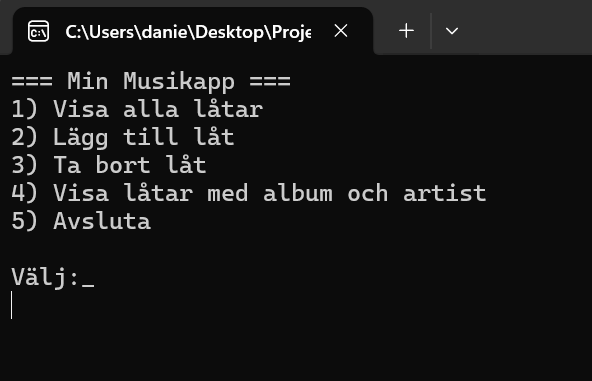

# Musiklistappen — [Daniella]

---

## Vad appen gör

Min app visar låtar och album från bandet Bad Omens. I menyn kan man välja mellan att 1) Lista alla deras låtar, 2) Lägga till en låt, 3) Ta bort en låt från listan, 4) visa artist, dess album och låttitlar eller 5) avsluta programmet.

## Så kör du den

```bash
git clone https://github.com/DaniRushton/daniella-clo26-musiklistappen.git
cd daniella-clo26-musiklistappen/MusikApp
dotnet run
```

Databasen `musik.db` ligger redan i mappen `MusikApp/` så inget behöves göras.

## Så ser huvudmenyn ut



---

## Mina designval (VG)

1. **Hur designade du din databas? Varför valde du just den strukturen?**

Jag gjorde en databas med fem olika tabeller: artist, song, album, genre och song_genre (dock fick inte genre/song_genre vara en del av detta projekt (förutom att programmet tar bort dessa bakom kulisserna ifall användaren väljer att deletea entiteter), det var förra inlämningen). Men att ha en tabell för varje sak för sig gör att all data bara behöver lagras en gång, istället för att exempelvis artistnamet inte behöver stå med på varje låt, utan artisten får ett unikt id och alla låtar kan bara kopplas till det id:et, samma med album; slipper jag skriva vem som äger alla låtar och album :)

2. **Vilket SQL-krav valde du (JOIN eller subquery) och varför passade det din app?**

Jag valde JOIN eftersom jag är mer intresserad i att se koppling mellan artist och album istället för att veta medellängden av låtarna artisten gjort. Sedan passar den ganska bra eftersom en låt innehåller bara album_id och ett album artist_id. så för att visa dessa två grejorna tillsammans behöver jag göra en JOIN klausul. 

3. **Vad skulle du gjort annorlunda om du byggde om den från scratch?**

Jag hade nog sett över så att min databas inte hade dubbletter av kod innan jag körde igång med kodningen (eftersom jag såg det först efter jag hade kommit igång med att koda), det skulle göra så att jag inte behöver lägga mer tid på att fixa databasen istälet för att bara fortsätta med given uppgift. 